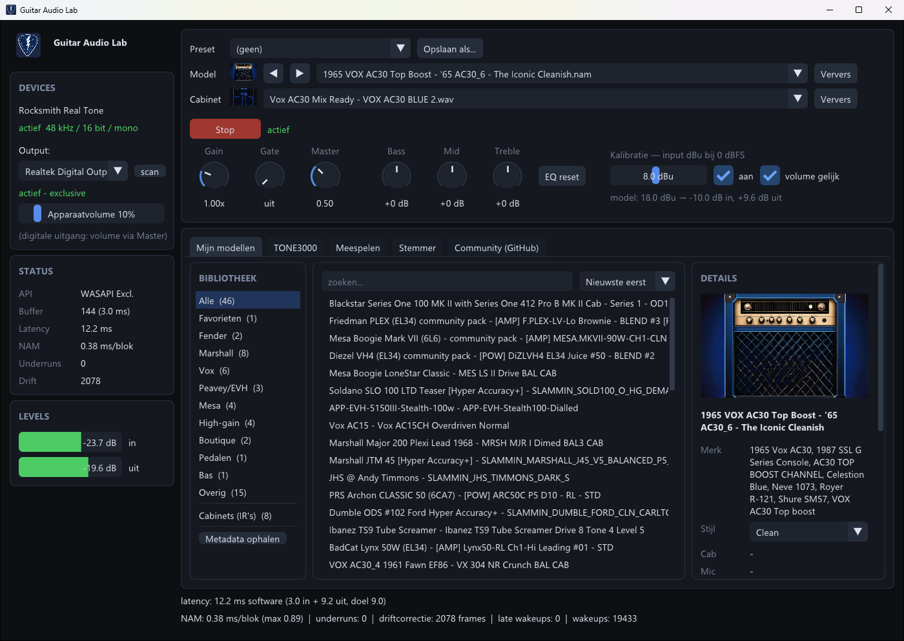
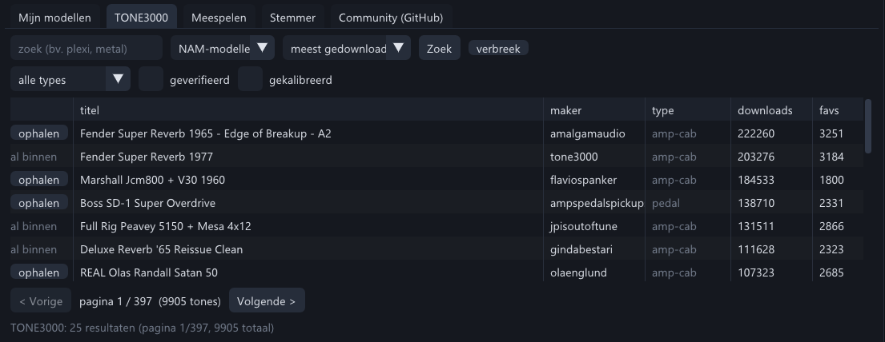
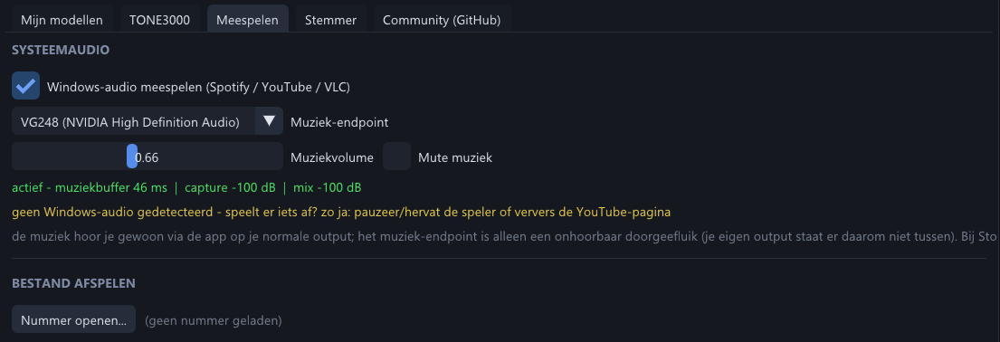
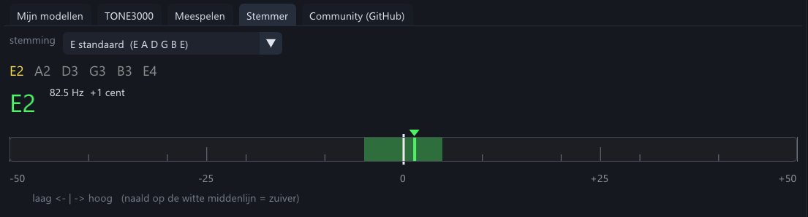

# Guitar Audio Lab

**Een gitaarversterker op je Windows-pc.** Sluit een elektrische gitaar aan met een Rocksmith Real Tone-kabel, kies een
versterker uit een bibliotheek van [Neural Amp Modeler](https://github.com/sdatkinson/NeuralAmpModelerCore)-captures,
zet er een speakerkast (cabinet-IR) achter en speel met lage latency naar je speakers of de optische S/PDIF-uitgang. Spotify of YouTube spelen mee op de achtergrond.

<p align="center">
  
</p>

## Wat kan het

- **Echte versterkers, als model.** NAM-captures van onder meer Fender, Marshall, Vox, Mesa en EVH, in een
  bibliotheek met categorieën, favorieten, zoeken, ratings en tags. Wisselen kan tijdens het spelen, zonder dat het
  geluid wegvalt.
- **Speakerkasten.** Cabinet-IR's (impulsresponsies) achter het model, of direct uit het model als de capture de kast
  al bevat.
- **De knoppen die je verwacht.** Gain, noise gate, master en een 3-bands EQ, plus **presets** die de complete
  instelling bewaren (model, kast, output).
- **Kalibratie.** Vertel de app welk niveau je kabel aflevert; dan krijgt elk model het ingangsniveau waarvoor het is
  opgenomen, en met *volume gelijk* klinken alle modellen even hard.
- **Nieuwe tones vinden.** Zoek in de duizenden tones op [TONE3000](https://www.tone3000.com) (populairste eerst,
  filters op type, geverifieerd en gekalibreerd) en haal ze met één klik binnen; of kies uit de GitHub-communitylijst.
- **Meespelen.** Alles wat Windows afspeelt (Spotify, YouTube, VLC) mixt mee in je gitaargeluid, of speel een
  audiobestand af.
- **Stemmer**, ook voor alternatieve stemmingen (drop D, drop C, ...).

<table>
  <tr>
    <td width="50%"></td>
    <td width="50%"></td>
  </tr>
  <tr>
    <td><b>TONE3000:</b> zoeken, filteren en met één klik ophalen.</td>
    <td><b>Meespelen:</b> Spotify of YouTube in je gitaargeluid gemixt.</td>
  </tr>
  <tr>
    <td colspan="2"></td>
  </tr>
  <tr>
    <td colspan="2"><b>Stemmer:</b> speel een losse snaar; standaard of een alternatieve stemming.</td>
  </tr>
</table>

## Hoe het werkt

```
gitaar → Rocksmith-kabel → WASAPI Exclusive → NAM-model → cabinet-IR → EQ → mix → S/PDIF of andere output
                                                                             ↑
                                                  Windows-audio (loopback) of een bestand
```

Alles draait in één native C++-programma (`native\guitar_amp_gui.exe`) met een GUI in
[Dear ImGui](https://github.com/ocornut/imgui). De lage latency was het eigenlijke onderzoek: van ~50 ms met een
standaard audiobibliotheek, via 17,5 ms, naar **4,8 ms** in de native passthrough, door de capture-events van de kabel
als klok te gebruiken en de output te pollen. Een NAM-model kost daarbovenop zo'n 0,1 tot 0,4 ms per blok. De app past zijn outputbuffer
per apparaat aan (zo klein als het zonder underruns kan; S/PDIF vraagt meer dan een analoge uitgang) en toont de
actuele latency, underruns en driftcorrectie live. Het hele verhaal per fase: [docs/onderzoek.md](docs/onderzoek.md).

## Wat heb je nodig

- Windows 11 en een **Rocksmith Real Tone Cable**: de input is nog aan deze kabel gekoppeld (mono, 16 bit, 48 kHz);
  een vrije inputkeuze staat op de roadmap.
- Een output: elk afspeelapparaat (getest met de optische Realtek-uitgang; Bluetooth via een shared-fallback).
- Visual Studio 2022 met de C++-workload, om te bouwen.
- Modellen en IR's: die haal je in de app binnen (een TONE3000-account met publishable key, of de communitylijst).

## Bouwen (Windows)

Eenmalig de NAM-bibliotheek bouwen:

```powershell
git clone --recurse-submodules https://github.com/Neil2222/guitar-audio-lab.git
cd guitar-audio-lab\third_party\NeuralAmpModelerCore
mkdir build_msvc; cd build_msvc
# vanuit een "x64 Native Tools"-prompt:
cl /std:c++20 /O2 /arch:AVX2 /EHsc /DNOMINMAX /DWIN32_LEAN_AND_MEAN /DNAM_ENABLE_A2_FAST ^
   /I.. /I..\Dependencies\eigen /I..\Dependencies\nlohmann /c ..\NAM\*.cpp ..\NAM\wavenet\*.cpp
lib /out:nam.lib *.obj
```

Daarna bouwt `native\build.ps1` alle tools, inclusief `guitar_amp_gui.exe`.
Let op bij het linken tegen nam.lib: `/WHOLEARCHIVE:` is verplicht (static
initializers registreren de netwerkarchitecturen).

**Niet in de repo** (zie `.gitignore`): persoonlijke instellingen/presets,
TONE3000-tokens (`t3k.json`), en gedownloade modellen/IR's: die haal je
zelf via de app binnen.

## Documentatie

| Document | Inhoud |
|---|---|
| [Onderzoek](docs/onderzoek.md) | Status per fase, kernbevindingen, de diagnostische scripts en tools |
| [Fase 1: inventarisatie](docs/fase1-inventarisatie.md) | De kabel, de optische uitgang, WASAPI en ASIO op dit systeem |
| [Fase 2: passthrough](docs/fase2-passthrough.md) | Python/PortAudio, ~17,5 ms |
| [Fase 3: native](docs/fase3-native.md) | C++/WASAPI, 4,8 ms en 0 underruns |
| [Fase 4: NAM](docs/fase4-nam.md) | Amp modelling in de pipeline |
| [Fase 5: GUI](docs/fase5-gui.md) | De app: bibliotheek, presets, cabinet-IR's, TONE3000 |
| [Fase 6](docs/fase6-onderzoek-systeemaudio.md) en [7](docs/fase7-systeemaudio.md): systeemaudio | Spotify en YouTube laten meespelen |

## Licentie

[MIT](LICENSE). Gebruikt [NeuralAmpModelerCore](https://github.com/sdatkinson/NeuralAmpModelerCore) en
[Dear ImGui](https://github.com/ocornut/imgui), beide MIT. Gedownloade modellen en IR's vallen onder de licentie van
hun makers en zitten daarom niet in de repo.
